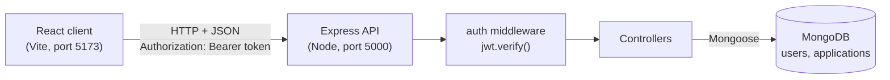

# Applyd - Job Application Tracker

A full-stack **MERN** web app for keeping track of job applications. Each user gets a private account where they record the jobs they applied to and move each one through a status workflow (Applied → Interview → Offer / Rejected). Every change is kept as a timeline, and applications that need a follow-up are flagged automatically.

Built as a college mini-project. The code is kept small and commented so every part can be explained.


---

## Contents

- [Features](#features)
- [Screenshots](#screenshots)
- [Tech stack](#tech-stack)
- [Architecture](#architecture)
- [Project structure](#project-structure)
- [Database design](#database-design)
- [API reference](#api-reference)
- [Getting started](#getting-started)
- [Demo account](#demo-account)
- [Environment variables](#environment-variables)
- [Available scripts](#available-scripts)
- [Deployment](#deployment)
- [How the key parts work](#how-the-key-parts-work)
- [Troubleshooting](#troubleshooting)
- [Viva questions](#viva-questions)
- [Future improvements](#future-improvements)
- [Author](#author)

---

## Features

| Feature | Description |
| --- | --- |
| **Authentication** | Register and log in with email + password. Passwords are hashed with bcrypt and sessions use JWT. |
| **Private data** | Each user sees and changes only their own applications. Enforced on the server for every request. |
| **Full CRUD** | Add, edit and delete applications: company, role, job link, location, salary expectation, applied date, status, interview date (optional) and notes. Delete asks for confirmation. |
| **Status workflow** | Applied → Interview → Offer / Rejected, changed with a simple dropdown from any view. |
| **Status history** | Every status change is saved as `{ status, changedAt }` and shown as a timeline on the detail page. |
| **Follow-up flag** | Shows a **Follow up** label when an application is still "Applied" more than 7 days after the applied date. |
| **List view** | Spreadsheet-style table with search (company or role), status filter and sort by applied date. |
| **Board view** | Four columns (Applied, Interview, Offer, Rejected) with cards grouped by status. Stacks on mobile. |
| **Stats cards** | Total, Applied, Interview, Offer, Rejected and **Response rate** = (Interview + Offer + Rejected) / Total. |
| **Feedback states** | Every request shows a loading state, and errors are shown as readable messages. |
| **Responsive** | Works on desktop and mobile. |

The UI is deliberately plain, like an internal tool: light grey background, white panels with thin borders, one teal accent colour, muted status colours, a monospace font for numbers, and dates shown as `15 Oct 2026`.

---

## Screenshots

> Add screenshots to a `screenshots/` folder and they will appear here.

| Login | Dashboard - list view |
| --- | --- |
|  |  |

| Dashboard - board view | Application detail with timeline |
| --- | --- |
|  |  |

---

## Tech stack

| Layer | Technology | Purpose |
| --- | --- | --- |
| Frontend | React 18, Vite 5 | Component-based UI, fast dev server and build |
| Routing | React Router 6 | Client-side pages and protected routes |
| HTTP | Axios | API calls, interceptors attach the JWT |
| State | React hooks + Context API | Local state per page, logged-in user shared via context |
| Styling | Plain CSS (3 files) | No UI kit or CSS framework |
| Backend | Node.js, Express 4 | REST API, middleware |
| Database | MongoDB, Mongoose 8 | Document storage, schemas and validation |
| Auth | jsonwebtoken, bcryptjs | Stateless tokens, password hashing |
| Dev tools | nodemon, dotenv, cors | Auto-restart, environment variables, cross-origin access |

Deliberately **not** used: TypeScript, Redux, UI component kits, chart libraries and drag-and-drop libraries.

---

## Architecture



**Request flow, e.g. changing a status:**

1. The user picks a new status in the dropdown.
2. Axios sends `PATCH /api/applications/:id/status`. The request interceptor adds the JWT from `localStorage`.
3. Express runs `cors` → `express.json` → the `auth` middleware, which verifies the token and sets `req.user.id`.
4. The controller finds the application with `{ _id: id, user: req.user.id }`, so it can only be the user's own.
5. It updates `status`, pushes `{ status, changedAt }` into `statusHistory`, and saves.
6. The updated document is returned. React updates the row/card, and the stats are reloaded.

---

## Project structure

```
applyd/
├── README.md
├── Applyd_Presentation_Guide.docx   # presentation + viva preparation guide
├── server/                          # Express + MongoDB API
│   ├── server.js                    # app entry: middleware, routes, error handler
│   ├── seed.js                      # creates a demo account with sample data
│   ├── config/
│   │   └── db.js                    # MongoDB connection
│   ├── models/
│   │   ├── User.js
│   │   └── Application.js           # status enum + statusHistory array
│   ├── middleware/
│   │   └── auth.js                  # verifies JWT, sets req.user
│   ├── controllers/
│   │   ├── authController.js        # register, login
│   │   └── applicationController.js # CRUD, status change, stats
│   ├── routes/
│   │   ├── authRoutes.js
│   │   └── applicationRoutes.js
│   ├── .env.example
│   └── package.json
└── client/                          # React + Vite frontend
    ├── index.html
    ├── vite.config.js
    ├── vercel.json                  # SPA rewrite for Vercel
    ├── .env.example
    ├── package.json
    └── src/
        ├── main.jsx                 # mounts App with Router + AuthProvider
        ├── App.jsx                  # route definitions
        ├── api/axios.js             # Axios instance + interceptors
        ├── context/AuthContext.jsx  # logged-in user, login(), logout()
        ├── utils/helpers.js         # date formatting, follow-up rule
        ├── components/
        │   ├── Navbar.jsx           # top bar: app name, user, Logout
        │   ├── ProtectedRoute.jsx   # redirects to /login without a token
        │   ├── StatsCards.jsx
        │   ├── ListView.jsx
        │   ├── BoardView.jsx
        │   ├── StatusBadge.jsx
        │   ├── StatusSelect.jsx
        │   ├── FollowUpLabel.jsx
        │   └── Timeline.jsx
        ├── pages/
        │   ├── Login.jsx
        │   ├── Register.jsx
        │   ├── Dashboard.jsx        # stats, toolbar, list/board toggle
        │   ├── ApplicationForm.jsx  # add + edit (same page)
        │   └── ApplicationDetail.jsx# details + status timeline
        └── styles/
            ├── base.css             # colour variables, typography, buttons, inputs
            ├── layout.css           # top bar, page layout, responsive rules
            └── components.css       # stats, table, board, badges, timeline
```

---

## Database design

### `users`

| Field | Type | Rules |
| --- | --- | --- |
| `name` | String | required |
| `email` | String | required, unique, lowercase |
| `password` | String | required, bcrypt hash only (never plain text) |
| `createdAt`, `updatedAt` | Date | automatic (`timestamps: true`) |

### `applications`

| Field | Type | Rules |
| --- | --- | --- |
| `user` | ObjectId → User | required, indexed (owner) |
| `company` | String | required |
| `role` | String | required |
| `appliedDate` | Date | required |
| `status` | String | enum: `Applied`, `Interview`, `Offer`, `Rejected` (default `Applied`) |
| `jobLink`, `location`, `salaryExpectation`, `notes` | String | optional |
| `interviewDate` | Date | optional |
| `statusHistory` | `[{ status, changedAt }]` | embedded array, one entry per status change |
| `createdAt`, `updatedAt` | Date | automatic (`timestamps: true`) |

`statusHistory` is **embedded** in the application instead of being a separate collection, because it is small and always read together with its application. One query loads everything.

---

## API reference

Base URL: `http://localhost:5000/api`

All `/applications` routes require the header `Authorization: Bearer <token>`.
Errors always have the form `{ "message": "..." }`.

| Method | Endpoint | Auth | Description | Success |
| --- | --- | :---: | --- | :---: |
| POST | `/auth/register` | - | Create an account, returns a token | 201 |
| POST | `/auth/login` | - | Log in, returns a token | 200 |
| GET | `/applications?search=&status=&sort=` | Yes | List the user's applications | 200 |
| GET | `/applications/stats` | Yes | Count per status + response rate | 200 |
| GET | `/applications/:id` | Yes | Get one application | 200 |
| POST | `/applications` | Yes | Create (adds the first history entry) | 201 |
| PUT | `/applications/:id` | Yes | Edit details | 200 |
| PATCH | `/applications/:id/status` | Yes | Change status + push to history | 200 |
| DELETE | `/applications/:id` | Yes | Delete | 200 |

**Status codes:** `400` validation error · `401` missing/invalid token or wrong credentials · `404` not found or not owned by the user · `409` email already registered · `500` server error.

<details>
<summary><b>POST /api/auth/register</b></summary>

Request
```json
{ "name": "Ravi Kumar", "email": "ravi@example.com", "password": "secret123" }
```
Response `201`
```json
{
  "token": "eyJhbGciOiJIUzI1NiIsInR5cCI6IkpXVCJ9...",
  "user": { "id": "6710f0c2a1b2c3d4e5f60718", "name": "Ravi Kumar", "email": "ravi@example.com" }
}
```
Error `409`
```json
{ "message": "Email is already registered" }
```
</details>

<details>
<summary><b>POST /api/auth/login</b></summary>

Request
```json
{ "email": "ravi@example.com", "password": "secret123" }
```
Response `200`: same shape as register.

Error `401`
```json
{ "message": "Invalid email or password" }
```
</details>

<details>
<summary><b>GET /api/applications?search=infy&status=Applied&sort=newest</b></summary>

| Query | Values | Meaning |
| --- | --- | --- |
| `search` | any text | matches company or role, case-insensitive |
| `status` | `Applied` / `Interview` / `Offer` / `Rejected` | filter by status |
| `sort` | `newest` (default) / `oldest` | order by applied date |

Response `200`
```json
[
  {
    "_id": "6710f1d9a1b2c3d4e5f60720",
    "user": "6710f0c2a1b2c3d4e5f60718",
    "company": "Infosys",
    "role": "Systems Engineer",
    "jobLink": "https://careers.infosys.com/job/123",
    "location": "Bengaluru",
    "salaryExpectation": "4.5 LPA",
    "appliedDate": "2026-10-01T00:00:00.000Z",
    "status": "Applied",
    "interviewDate": null,
    "notes": "Applied through campus portal",
    "statusHistory": [{ "status": "Applied", "changedAt": "2026-10-01T09:12:44.120Z" }],
    "createdAt": "2026-10-01T09:12:44.125Z",
    "updatedAt": "2026-10-01T09:12:44.125Z"
  }
]
```
</details>

<details>
<summary><b>GET /api/applications/stats</b></summary>

Response `200`
```json
{ "total": 8, "Applied": 4, "Interview": 2, "Offer": 1, "Rejected": 1, "responseRate": 50 }
```
</details>

<details>
<summary><b>GET /api/applications/:id</b></summary>

Response `200`: one application object (same shape as above).

Error `404`
```json
{ "message": "Application not found" }
```
</details>

<details>
<summary><b>POST /api/applications</b></summary>

Request
```json
{
  "company": "Infosys",
  "role": "Systems Engineer",
  "jobLink": "https://careers.infosys.com/job/123",
  "location": "Bengaluru",
  "salaryExpectation": "4.5 LPA",
  "appliedDate": "2026-10-01",
  "status": "Applied",
  "interviewDate": null,
  "notes": "Applied through campus portal"
}
```
Response `201`: the created application, with
```json
"statusHistory": [{ "status": "Applied", "changedAt": "2026-10-01T09:12:44.120Z" }]
```
Error `400`
```json
{ "message": "Company is required" }
```
</details>

<details>
<summary><b>PUT /api/applications/:id</b></summary>

Edits details only. `status` is ignored here; use the PATCH route.

Request
```json
{ "location": "Pune", "interviewDate": "2026-10-20", "notes": "HR call scheduled" }
```
Response `200`: the updated application.

Error `404`
```json
{ "message": "Application not found" }
```
</details>

<details>
<summary><b>PATCH /api/applications/:id/status</b></summary>

Request
```json
{ "status": "Interview" }
```
Response `200` (other fields shortened)
```json
{
  "_id": "6710f1d9a1b2c3d4e5f60720",
  "company": "Infosys",
  "status": "Interview",
  "statusHistory": [
    { "status": "Applied", "changedAt": "2026-10-01T09:12:44.120Z" },
    { "status": "Interview", "changedAt": "2026-10-09T15:30:02.511Z" }
  ]
}
```
Error `400`
```json
{ "message": "Status must be Applied, Interview, Offer or Rejected" }
```
</details>

<details>
<summary><b>DELETE /api/applications/:id</b></summary>

Response `200`
```json
{ "message": "Application deleted", "id": "6710f1d9a1b2c3d4e5f60720" }
```
Error `404`
```json
{ "message": "Application not found" }
```
</details>

---

## Getting started

### Prerequisites

- [Node.js](https://nodejs.org/) 18 or newer
- MongoDB: either a free [MongoDB Atlas](https://www.mongodb.com/cloud/atlas) cluster **or** MongoDB Community Server installed locally

### 1. Clone

```bash
git clone https://github.com/TARUNprojectworks/applyd.git
cd applyd
```

### 2. Set up the database

**Option A: local MongoDB.** Install MongoDB Community Server and use:
```
MONGO_URI=mongodb://127.0.0.1:27017/applyd
```

**Option B: MongoDB Atlas (free tier).**
1. Create a free **M0** cluster.
2. **Database Access** → add a database user (avoid `@ : /` in the password).
3. **Network Access** → add `0.0.0.0/0` (allow from anywhere; needed for Render).
4. **Connect → Drivers** → copy the connection string and add the database name `applyd`:
   ```
   mongodb+srv://<user>:<password>@cluster0.xxxxx.mongodb.net/applyd?retryWrites=true&w=majority
   ```

### 3. Start the backend

```bash
cd server
npm install
cp .env.example .env      # Windows PowerShell: copy .env.example .env
# edit .env and set MONGO_URI and JWT_SECRET
npm run seed              # optional: creates the demo account
npm run dev
```

You should see `MongoDB connected` and `Server running on port 5000`.
Check http://localhost:5000, which returns `{"message":"Applyd API is running"}`.

### 4. Start the frontend (new terminal)

```bash
cd client
npm install
npm run dev
```

Open **http://localhost:5173**.

---

## Demo account

After running `npm run seed` in `server/`:

| Email | Password |
| --- | --- |
| `demo@applyd.com` | `demo123` |

It has 8 sample applications covering every status, interview dates, multi-step status timelines and some applications showing the **Follow up** label. Running the seed again resets the demo data.

---

## Environment variables

### `server/.env`

| Variable | Required | Example | Description |
| --- | :---: | --- | --- |
| `MONGO_URI` | Yes | `mongodb://127.0.0.1:27017/applyd` | MongoDB connection string |
| `JWT_SECRET` | Yes | long random string | Secret used to sign and verify tokens |
| `PORT` | No | `5000` | API port (Render sets this automatically) |
| `CLIENT_URL` | No | `http://localhost:5173` | Allowed CORS origin. If not set, all origins are allowed. |

Generate a secret with:
```bash
node -e "console.log(require('crypto').randomBytes(32).toString('hex'))"
```

### `client/.env` (optional locally)

| Variable | Default | Description |
| --- | --- | --- |
| `VITE_API_URL` | `http://localhost:5000/api` | Base URL of the API |

`.env` files are git-ignored. Only the `.env.example` templates are committed.

---

## Available scripts

| Folder | Command | What it does |
| --- | --- | --- |
| `server` | `npm run dev` | Start the API with nodemon (auto-restart) |
| `server` | `npm start` | Start the API with node (production) |
| `server` | `npm run seed` | Create/reset the demo account and sample data |
| `client` | `npm run dev` | Start the Vite dev server |
| `client` | `npm run build` | Build for production into `client/dist` |
| `client` | `npm run preview` | Preview the production build |

---

## Deployment

### Backend → Render

1. **New → Web Service** and connect this repository.
2. Root directory `server`, build command `npm install`, start command `npm start`, instance type Free.
3. Environment variables: `MONGO_URI` (Atlas), `JWT_SECRET`, `CLIENT_URL` (your Vercel URL).
4. Deploy and copy the URL, e.g. `https://applyd-api.onrender.com`.

The free tier sleeps after about 15 minutes idle, so the first request can take 30-50 seconds.

### Frontend → Vercel

1. **Add New → Project** and import this repository.
2. Root directory `client`, framework preset **Vite**.
3. Environment variable `VITE_API_URL` = `https://applyd-api.onrender.com/api`.
4. Deploy. `vercel.json` rewrites every path to `index.html` so refreshing a page like `/applications/123` works.
5. Put the Vercel URL in `CLIENT_URL` on Render and redeploy the backend.

---

## How the key parts work

**JWT authentication.** On login the server checks the password with `bcrypt.compare()` and signs a token with `jwt.sign({ id }, JWT_SECRET, { expiresIn: '7d' })`. The client stores it in `localStorage`, and an Axios interceptor sends it on every request. `middleware/auth.js` verifies it and sets `req.user.id`. If the server returns 401, the client logs the user out.

**Data isolation.** The user id comes only from the verified token, never from the request body. Every query includes it (`find({ user })`, `findOne({ _id, user })`, `findOneAndDelete({ _id, user })`). Asking for another user's application returns `404`, which doesn't reveal that it exists.

**PUT vs PATCH.** `PUT /:id` edits details. `PATCH /:id/status` changes only the status, because that has a side effect: it adds a `statusHistory` entry. A history entry is added only when the status actually changes.

**Stats aggregation.** One pipeline:
```js
Application.aggregate([
  { $match: { user: new mongoose.Types.ObjectId(req.user.id) } }, // only this user's docs
  { $group: { _id: '$status', count: { $sum: 1 } } },            // count per status
]);
```
The controller fills missing statuses with 0 and calculates the total and response rate.

**Follow-up rule** (frontend, `utils/helpers.js`):
```js
status === 'Applied' && (Date.now() - appliedDate) / (1000 * 60 * 60 * 24) > 7
```
It isn't stored in the database because it depends on today's date.

**Search.** Case-insensitive regex on company **or** role (`$or`). Special characters are escaped so input like `C++` is safe. The dashboard waits 300 ms after typing before it sends the request (debounce).

---

## Troubleshooting

| Problem | Cause | Fix |
| --- | --- | --- |
| `querySrv EBADNAME _mongodb._tcp.<cluster>.mongodb.net` | `MONGO_URI` still contains the placeholder from `.env.example` | Put a real Atlas string or `mongodb://127.0.0.1:27017/applyd` in `server/.env` |
| `MongoDB connection failed: connect ECONNREFUSED 127.0.0.1:27017` | Local MongoDB isn't running | Start the **MongoDB** service (Windows: `services.msc`) |
| Blank white page at `localhost:5173` with another app's title | A service worker from a previous project on the same port is serving its cache | DevTools → Application → Service workers → **Unregister**, then Storage → **Clear site data**, then Ctrl+Shift+R. Or open `127.0.0.1:5173`. |
| "Could not reach the server" in the UI | API not running or wrong `VITE_API_URL` | Start the server, check the URL, restart `npm run dev` after editing `.env` |
| CORS error in the browser console | `CLIENT_URL` doesn't match the frontend origin | Set `CLIENT_URL` to the exact frontend URL (no trailing slash) |
| Editor freezes when opening the folder | VS Code indexing `node_modules` | `.vscode/settings.json` in this repo excludes it |

---

## Viva questions

Short answers to the most likely questions. The full set (20 questions, a demo script and an architecture walkthrough) is in [`Applyd_Presentation_Guide.docx`](Applyd_Presentation_Guide.docx).

<details>
<summary><b>1. How does JWT authentication work in this app?</b></summary>

The server signs a token containing the user id after a successful login. The client stores it and sends it as `Authorization: Bearer <token>`. The `auth` middleware verifies the signature and expiry on every protected route, then sets `req.user`. The server keeps no sessions, so it's stateless.
</details>

<details>
<summary><b>2. Why bcrypt? What is a salt?</b></summary>

bcrypt is a slow one-way hash, so leaked hashes are hard to crack. A random salt is mixed in, so equal passwords produce different hashes, which defeats rainbow tables. `10` is the cost factor.
</details>

<details>
<summary><b>3. PUT vs PATCH: why both?</b></summary>

PUT updates the resource's details. PATCH is a partial update. The status has its own PATCH route because it also records history, so editing notes can never create a fake history entry.
</details>

<details>
<summary><b>4. What makes the API RESTful?</b></summary>

Resource-based URLs, HTTP methods as actions, stateless requests (the token is sent each time), proper status codes and JSON bodies.
</details>

<details>
<summary><b>5. What is a Mongoose schema?</b></summary>

It defines the shape and rules of documents: types, required fields, enums and defaults. Mongoose validates against it on `create()` and `save()`. `timestamps: true` adds `createdAt`/`updatedAt`.
</details>

<details>
<summary><b>6. Explain the aggregation pipeline.</b></summary>

`$match` keeps only the user's documents. `$group` groups by `status` and counts with `$sum: 1`. Stages run in order. `aggregate()` doesn't cast types, so the id is converted to an `ObjectId` by hand.
</details>

<details>
<summary><b>7. How does statusHistory work?</b></summary>

On create, the first entry is added. On `PATCH /status`, if the status changed, the server pushes `{ status, changedAt }` and saves. The `Timeline` component shows the array.
</details>

<details>
<summary><b>8. How is user data isolated?</b></summary>

Every query filters by `req.user.id` from the verified token. Another user's id finds nothing, so the API returns 404.
</details>

<details>
<summary><b>9. How is the follow-up flag calculated?</b></summary>

On the frontend: still `Applied` and more than 7 days since `appliedDate`. It depends on today's date, so it isn't stored.
</details>

<details>
<summary><b>10. How do search, filter and sort work?</b></summary>

Query params are sent to the server, which builds a Mongo filter (`$or` regex on company/role, `status`) and sorts by `appliedDate` ascending or descending. The frontend debounces typing by 300 ms.
</details>

<details>
<summary><b>11. How do protected routes work on the frontend?</b></summary>

`ProtectedRoute` redirects to `/login` if there is no token. This is only for the UI. The server checks the token on every request anyway, and a 401 response logs the user out.
</details>

<details>
<summary><b>12. Why is <code>/stats</code> defined before <code>/:id</code>?</b></summary>

Express matches routes in order. Otherwise `stats` would be treated as an `:id`.
</details>

---

## Future improvements

- Email reminders for follow-ups and upcoming interviews
- Drag and drop on the board view
- Pagination for large lists
- Resume / cover letter upload per application
- httpOnly cookie tokens, refresh tokens and login rate limiting
- Charts of applications over time

---

## Author

**Tarun**: [@TARUNprojectworks](https://github.com/TARUNprojectworks)

College mini-project, 2026.
